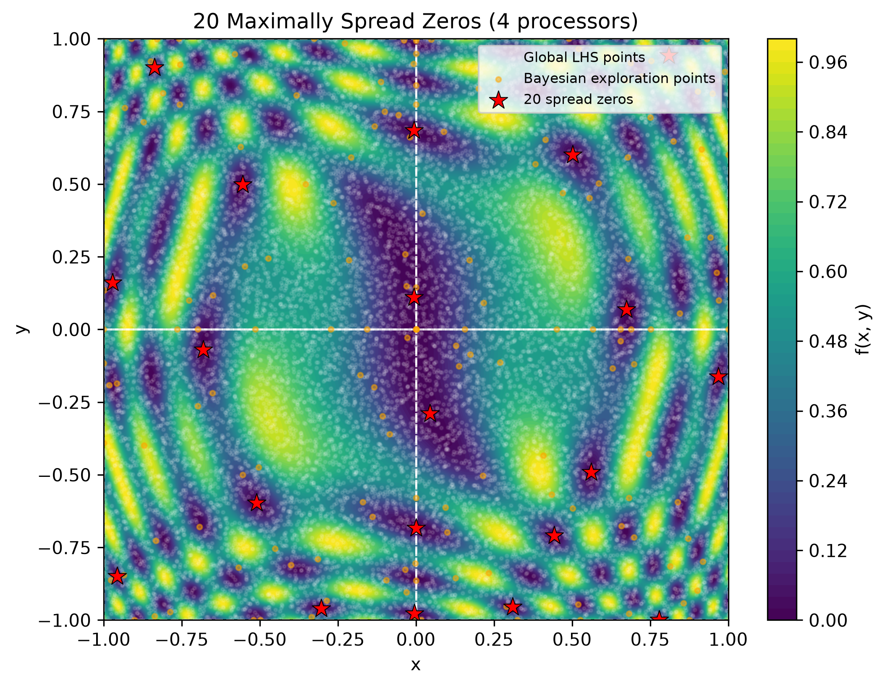
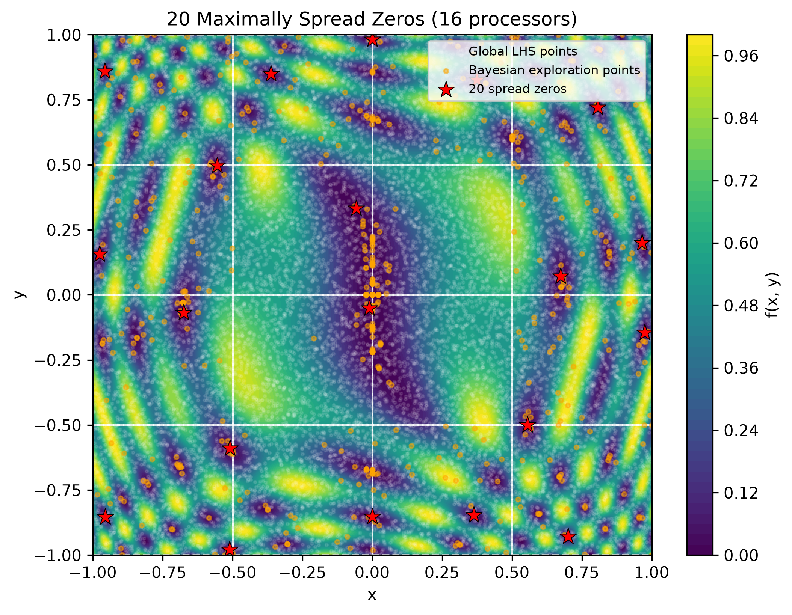
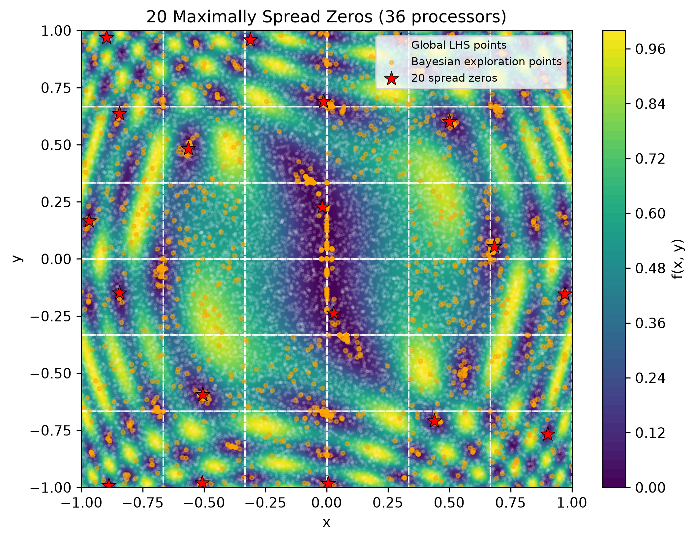
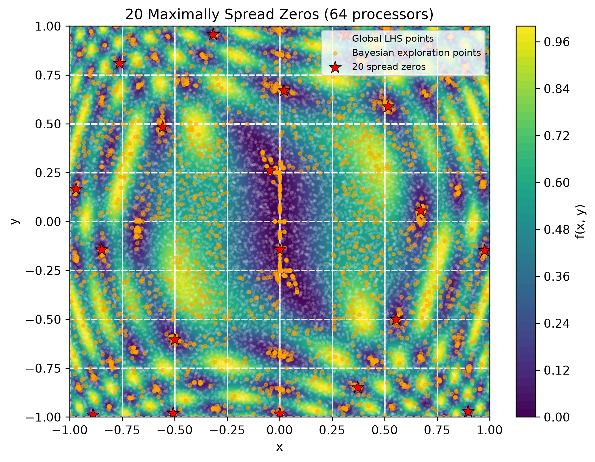

# Project 2 Question 4:

## Project Description

Goal: How can you use parallel processing to speed up the process of finding zeros within a sample space while being efficent while dealing with load imbalances

For this problem, I am looking to find 20 widely spread zeros of following function:

$$
u(x, y) = \frac{1}{2} [\sin^2(c\phi_1) + \sin^2(c\phi_2)]
$$

where $c=10$ over the domain $\Omega = (-1, 1)^2$ where the governing equations are:

$$
\phi_1(x, y) = x(x^2 + y^2)
$$

and 

$$
\phi_2(x, y) = y^3 - x^2y + 0.5x
$$

There are two main considerations as to how to formulate the problem.

1. Do you do domain composition, leading to possible load imbalances, especially when some areas may not have any zeros?

2. Do you look at the entire space which may be difficult to cordinate between multiple processors. 


## Program Structure

Files included on this project
- [enviornment.yml](/project2/environment.yml): The conda enviornment that was used to run this code
- [output.txt](/project2/output.txt): Text output, not relevant to this problem but gives a bit of an insight to the logging statements that were used, sharing where each region was and how many sample point each had
- [project2.slurm](/project2/project2.slurm): The bash script submitted to Seawulf (with `sbatch project2.slurm`) that started the program.
- [/results](/project2/results): the folder that was used to hold all of the plot outputs for the different number of processors (4, 16, 32, 64)

### Code Analysis

My code makes use of a python-based optimization package [Xopt](https://xopt.xopt.org/), devloped out of SLAC National Accelerator Laboratory. This was used as I am familiar with this package and I wanted to gain more hands-on expierence with using it in practie, even though more simplier methods could have been used. In practice Xopt, has a built in MPI way to code, but this was not used, nor referenced.

The general idea of the code is to sample the entire sample space at the start using [Latin hypercube sampling](https://en.wikipedia.org/wiki/Latin_hypercube_sampling). This allows for, with enough sample points, for the samples to be more or less evenly distributed over the entire sample space. 

This is crucial in the problem specifically since considering the highly oscillating nature of this function, and the large valley around (0,0), other sampling methods tended to get stuck. Additionally, with allowing each seperate processor to sample their own sub space, there tended to be a larger congrgation of samples near the edges of the region, which for processors that included the middle region, resulted in many many zeros being stuck there.

Once the head processor, rank 0, finished sampling the sample space, the entre sample space was divided, evenly between each of the processors, and one region, and the sample points that belong to it was scattered between all processors. 

In order to prevent our selected zeros from getting stuck, and to promote the exploration, these sample points were thinned. First, points had to be at minimum 0.02 away from each other. Next, between all of these remaining points, the best 100 points, where best is defined being closest to 0 were selected. Additionally, another 100 points were also randomly selected, so that the following Bayesian Exploration model would not get stuck.

After we thinned the data, we used the Bayesian Exploration Generator optimization, more information regarding the configuration of the Xopt agent can be found [here](/project2/results/additional_information.txt) that is also primed for exploration but with an additional constraint that it is looking for locations with results in u(x,y) < 0.01. This optimization is ran for 40 iterations. 

The data is than collected back into processor 0 where the zeros that were found for each processor are analyzed and than are slected to be one of the 20 zeros required for the project if they are maximally spread out from each other. 

This is the above written out in pseudocode:
```text
Initialize MPI environment (COMM, rank, size)
Define domain [-1, 1] for x and y and function u(x, y)

IF rank == 0 THEN
    Setup global VOCS with variables x, y and objective "EXPLORE"
    Generate 16,384 points using Latin Hypercube Sampling (LHS)
    Partition domain into a grid of size (n × n) so that there is one region per processormatching processor count
    Slice global LHS dataset into chunks corresponding to each subdomain region
END IF

Scatter domain chunks and regional bounds from Rank 0 to all workers

For each local processor:
    Receive regional slice of LHS data (region_df)
    Thin and cap seed data using space-filtering and random sub-sampling
    Initialize local Xopt instance with BayesianExplorationGenerator (BEG) with local bounds [x1, x2] × [y1, y2]
    Run 40 steps of Bayesian optimization exploration
    Extract newly generated local points

Gather all local Bayesian Optimization points at Rank 0 using MPI.gather()

IF rank == 0 THEN
    Combine global LHS points and gathered BO points into a unified dataset
    Filter candidate zeros where f(x, y) < 0.005
    Apply greedy max-min dispersion algorithm to select k = 20 maximally separated zeros from the BEG points
    Generate and save visualization plots (showing the zeros (stars), sample points from LHS (white circles), and BEG points (orange circles))
END IF
```

To successfully recreate this code, you would have to use the enviornment configuration as described in [enviornment.yml](/project2/environment.yml), which installs `xopt` for optimization, `matplotlib-base` for visualization, `numpy` and `pandas` for data manipulation, and `mpi4pi` for running the code in parallel.

Additionally, you must run `sbatch project2.slurm` with the conda enviornment, which I called `my_parallel_env`, already activated. I couldn't get the packages to load right when it wasn't running.

## Results

In total, there were 16384 sample points that were generated from LHS across the sample space, which, at least for the 16 processor example, resulted in about 1000 points per region. 

These were the results of the optimization using a different number of processors. 

Please note that some of the 20 selected zeros are behind the legend. To view the graphs better, you can view them [here](project2/results)

| | |
| :---: | :---: |
|  |  |
|  |  |


## Analysis

My solution to this delemma was to use domain decomposition with an inital work with initial work done by the main process.

### Performance Analysis

#### **Load Balancing**

As this function is highly oscillalaric, one of the big concerns was how to properly seperate the work out between the processors so that that they each would have equal amounts. I decided to deal with this by evenlly dividing the sample space as the function was more or less symmetric. While this caused slight load imbalances, especially for runs with more processors, it limited the amount of communication that had to occur and allowed for each of the processors to run in parallel.


#### **Communication between Processors**

Due to the parallelization with each processor being independent, there is not a large amount of communication that occurs. There is only the inital data scattering and the data collection by processor 0. 

The process however, is limited by the slowest running processor as Comm.Barrier() has to wait until it is done before the final round of analysis can even start.

#### **Scaliability**: 

As the number of processors increase, the sample space that each of the processors have to look at decreases. However, this can lead to increased load imbalance as there might be more and more regions where there are no zeros, so searching the area is useless. 

Additionally, if you go too small, there has to be more randoly sampled points from the LHS and more iterations of the BEG in order to get a better understanding of the entire space. 

This means that there should be trial and error to determine the optimial configuration of how many processors should be used, as well as smarter configurations of how the sample space should be divided. 


#### **Running Time and Efficency**

This was slightly suprising. While I did expect the run with the most processors to be most confident about where the zeros were and the run with only 4 processors to be the least confident, I did not expect that the middle two runs would be comparable.

Comparing the graphs between the runs and their running time, I believe that of the variations tried, the 36 processor run privided the best tradeoff with the amount of resources it required, the run time, and confidence of where the minima are. If I had unlimited resources, the 64 processor run would be perferrable as it found most if not all of the zeros.  

| Number of Processors | Running Time |
| :--- | :--- |
| 4 | 142.45234375001746 seconds |
| 16 | 105.27970193899819 seconds |
| 36 | 111.17167537499336 seconds |
| 64 | 117.11798412899952 seconds |
