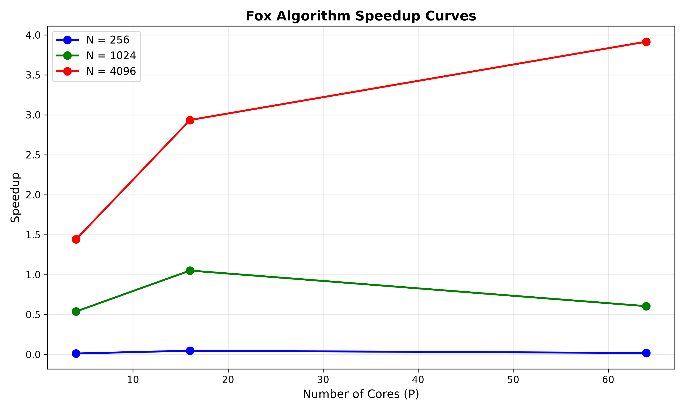
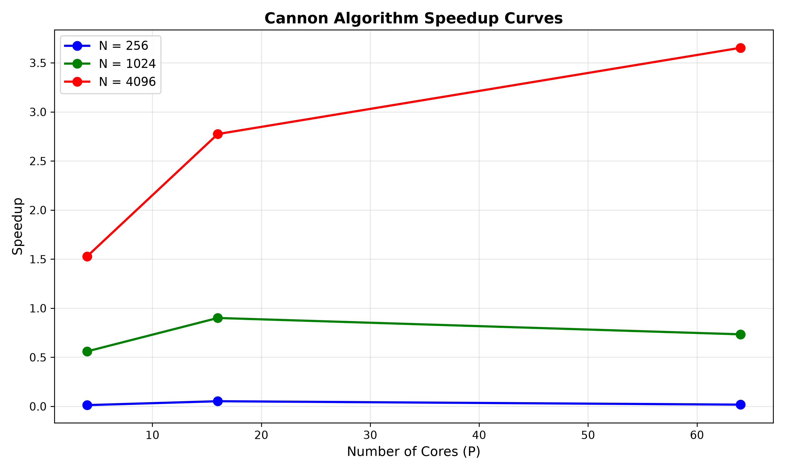

# Project 2 Question 4:

## Project Description

Goal: How do you implement different parallel computing algorithms for matrix multiplication?

This project is looking at two popular methods, Cannon's and Fox's algorithm for two `N`x`N` matrixes that have values between (-1,1]

## Program Structure

Files included on this project
- [fox_algorithm.py](/project3/fox_algorithm.py): The source code for the fox parallel algorithm

- [fox_output.txt](/project3/fox_output.txt): Output file that gives the runtime of the parallel algorthm, the serial baseline as well as a check that both are equal

- [cannon_algorithm.py](/project3/cannon_algorithm.py): The source code for the cannon parallel algorithm

- [cannon_output.txt](/project3/cannon_output.txt): Output file that gives the runtime of the parallel algorthm, the serial baseline as well as a check that both are equal

- [fox_project.slurm](/project3/fox_project.slurm): The bash script submitted to Seawulf (with `sbatch fox_project.slurm`) that started the program.

- [cannon_project.slurm](/project3/cannon_project.slurm): The bash script submitted to Seawulf (with `sbatch cannon_project.slurm`) that started the program.

## Code Analysis

### Algorithm Description:

#### Fox Algorithm
The General idea of the algorithm is that within each row, a single element is broadcasted to all other processors within the same row of matrix A. We start at the element (i,i) than each new iteration j, we broadcast (i,i+j)

After the broadcast, we use a local subsect of the resulting matrix and populate that with the result of the local matrix multiplication. Each iteration after the local result matrices are added together

We also need to circulaly rotate the local data for the B matrix. Each coloumn is roatated to the processor at index one above them. 

We than keep repeating this process until we have done it until each element of a row has been broadcasted, which ends of being sqrt(number of processors) times


The Puesdocode:
``` text
q = sqrt(number of processors)

# Each processor P(i, j) has local matrices A_local, B_local of size (n/q) x (n/q)
# Assign each processor in order to keep the original layout of the matrixes

C_local = 0.0  # Initialize local result sub-matrix to zero in the shape of (n/q) x (n/q)

# Determine neighbor ranks for vertical communication in the grid
up_rank   = ((y - 1 + grid_rows) mod grid_rows) * grid_cols + x
down_rank = ((y + 1) mod grid_rows) * grid_cols + x

For step = 0 to grid_rows - 1:
    # Determine the root column in the current row for broadcasting A
    root_col = (y + step) mod grid_cols

    # Prepare buffer for broadcasting A across the processor row
    If x == root_col then
        broadcast_A = local_A
    Else
        broadcast_A = empty buffer with same shape as local_A
    End If

    # Broadcast A from the root column to all processors in the same row
    Broadcast broadcast_A from processor column root_col across row_comm

    # Multiply received A sub-matrix with local B and accumulate into local C
    local_C = local_C + (broadcast_A * local_B)

    # Shift local_B blocks upward along the processor column
    recv_B = empty buffer with same shape as local_B
    Send local_B to up_rank and receive recv_B from down_rank simultaneously
    
    # Update local_B with the shifted data
    local_B = recv_B
End For
```
#### Cannon Algorithm
The general idea of the algorithm is that before any multiplication begins, the initial data blocks are skewed. Each row of matrix $A$ is circularly shifted left by an amount equal to its row index, and each column of matrix $B$ is circularly shifted upward by an amount equal to its column index.

Once aligned, each processor multiplies its current local sub-matrices of $A$ and $B$, summing the product into its local result matrix $C$.

After the local multiplication, the data is shifted in a circle before the next iteration. Every sub-matrix of $A$ is shifted one position to the left along its row, and every sub-matrix of $B$ is shifted one position upward along its column.

We then keep repeating this process, multiplying locally and then shifting both matrices—until the loop runs sqrt(number of processors) times, ensuring every processor has interacted with all required sub-matrices across the grid.

The Puesdocode:
```text
q = sqrt(number of processors)

# Each processor P(i, j) has local matrices A_local, B_local of size (n/q) x (n/q)

# Assign each processor in order to keep the original layout of the matrixes

C_local = 0.0  # Initialize local result sub-matrix to zero in the shape of (n/q) x (n/q)

# Compute neighbor ranks
left_rank  = y * grid_cols + (x - 1 + grid_cols) mod grid_cols
right_rank = y * grid_cols + (x + 1) mod grid_cols
up_rank    = ((y - 1 + grid_rows) mod grid_rows) * grid_cols + x
down_rank  = ((y + 1) mod grid_rows) * grid_cols + x

# Initial shift of local_A up by y steps along the processor row
For step = 0 to y - 1:
    rec_A = empty buffer with same shape as local_A
    Send local_A to left_rank and receive rec_A from right_rank
    local_A = rec_A
End For

# Initial shift of local_B up by x steps along the processor column
For step = 0 to x - 1:
    rec_B = empty buffer with same shape as local_B
    Send local_B to up_rank and receive rec_B from down_rank
    local_B = rec_B
End For

For step = 0 to grid_cols - 1:
    # Matrix multiplying the local versions of A and B than adding it to what is stored in the local result matrix
    local_C = local_C + (local_A * local_B)

    # Shift blocks for the next iteration
    If step < grid_rows - 1 then
        recv_A = empty buffer with same shape as local_A
        recv_B = empty buffer with same shape as local_B
        
        Send local_A to left_rank and receive recv_A from right_rank
        Send local_B to up_rank and receive recv_B from down_rank
        
        local_A = recv_A
        local_B = recv_B
    End If
End For
```
## Results
Fox
```
========================================================
Speedup Analysis for Fox Algorithm
========================================================
Matrix Size N = 256:
Cores      Serial (sec)      Parallel (sec)    Speedup   
--------------------------------------------------
4          0.001409        0.118074        0.0119    
16         0.001660        0.035265        0.0471    
64         0.003854        0.207760        0.0186    

Matrix Size N = 1024:
Cores      Serial (sec)      Parallel (sec)    Speedup   
--------------------------------------------------
4          0.076157        0.141666        0.5376    
16         0.081554        0.077648        1.0503    
64         0.075067        0.124131        0.6047    

Matrix Size N = 4096:
Cores      Serial (sec)      Parallel (sec)    Speedup   
--------------------------------------------------
4          2.860235        1.985612        1.4405    
16         3.193206        1.087929        2.9351    
64         3.351671        0.855980        3.9156    
```


Cannon
```
==========================================================
Speedup Analysis for Cannon Algorithm
==========================================================

Matrix Size N = 256:
Cores      Serial (sec)      Parallel (sec)    Speedup   
------------------------------------------------------
4          0.001429           0.112270        0.0127    
16         0.001863           0.035519        0.0525    
64         0.001665           0.094837        0.0176    

Matrix Size N = 1024:
Cores      Serial (sec)      Parallel (sec)    Speedup   
-----------------------------------------------------
4          0.076765           0.137039        0.5602    
16         0.083163           0.092340        0.9006    
64         0.077952           0.106184        0.7341    

Matrix Size N = 4096:
Cores      Serial (sec)      Parallel (sec)    Speedup   
-----------------------------------------------------
4          2.875673           1.881836        1.5281    
16         3.150861           1.135695        2.7744    
64         3.300294           0.903394        3.6532    
```



### Comparing the speed-up curves
There does not appear to be any visiable differences between the two speedup curves, even the overrun time of the two methods are similar. 

## Analysis

### Perforance Differences
There does not appear to be any performance differences between the two methods. Therefore, when doing matrix multiplication yourself, the selection of which method to use should be based on ease of implimentation. 

### Perforance Trends
In regards to performance, the serial method when compared to both algorithms seemed to outperform the parallel method when the matrix size is smaller (256 or 1024). However, when the matrix is 4096x4096, the parallel algorthms using both Fox and Cannon was perferred. 

When using parallel computing, there is an overhead set-up and commuication between the processors which is the reason why the parallel ways are not always perferred. This shows that depending on the matrix, there must be some analysis done to ensure you are selecting the quickest method for the data you are using.

### Scaliability
From what I observed between the two methods and the speedup betwen all of the cases, there doesn't seem to be much of a difference the two methods as both methods had very similar speedup curves for all cases. Therefore, I would expect the two to perform similarly at large matrix sizes

While Fox's algorithm is easier to impliment, there does not seem to be much of a different between the methods.